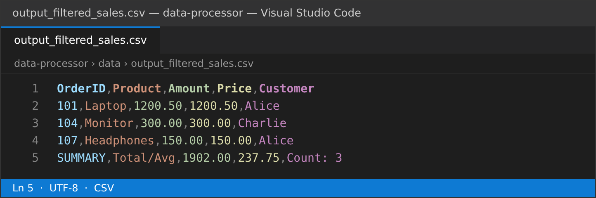
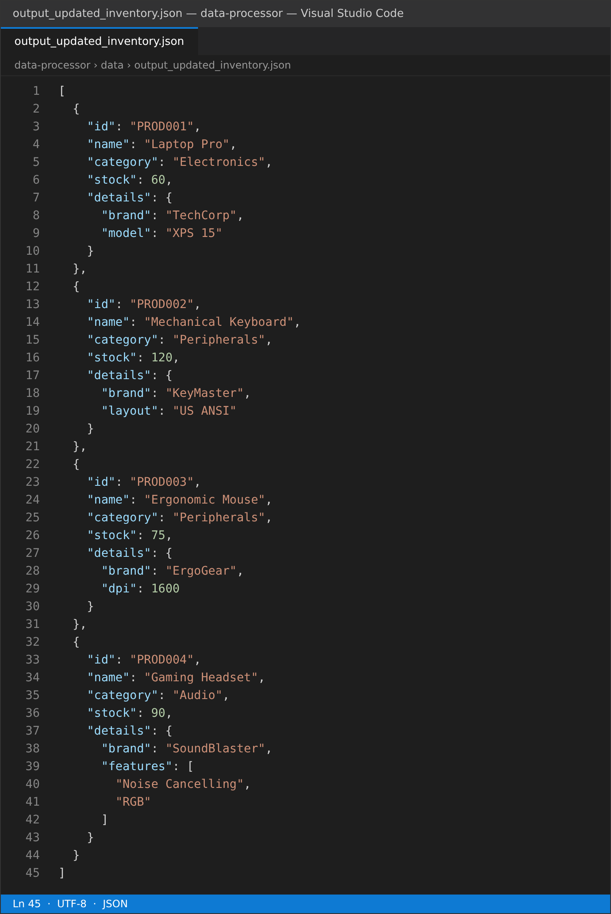

# Lab Week 8: Automating with CSV and JSON Data

SP352301 Script Programming — ภาคเรียน 1/2569

โปรเจกต์นี้ฝึกอ่าน เขียน และประมวลผลไฟล์ข้อมูลแบบ plaintext สองรูปแบบหลัก คือ **CSV** และ **JSON** ด้วยโมดูล `csv` และ `json` ที่มากับ Python

## Key Concepts Demonstrated

* **CSV Reading (`csv.DictReader`)** — อ่าน CSV โดยใช้แถวแรกเป็น header ได้ข้อมูลเป็น list ของ dict
* **CSV Writing (`csv.DictWriter`)** — เขียน list ของ dict กลับเป็นไฟล์ CSV พร้อม header
* **CSV Data Processing** — หาผลรวม ค่าเฉลี่ย และกรองข้อมูลตามเงื่อนไข (แปลง string เป็น `float` ก่อนคำนวณ)
* **JSON Reading (`json.load`)** — แปลงไฟล์ JSON เป็น list / dict ของ Python
* **JSON Writing (`json.dump`)** — เขียน Python object เป็นไฟล์ JSON แบบ pretty-print (`indent`)
* **JSON Data Manipulation** — เข้าถึงข้อมูลซ้อน (nested), อัปเดต stock, เพิ่มสินค้าใหม่
* **Modular Design** — แยก logic เป็น `csv_handler.py`, `json_handler.py`, `utils.py`
* **Robustness** — มี `try/except` จัดการไฟล์หาย, JSON ผิดรูปแบบ, แปลงตัวเลขไม่ได้

## Setup & How to Run

```bash
git clone https://github.com/sarid101/data-processor.git
cd data-processor
python main.py
```

ไม่ต้อง `pip install` อะไรเพิ่ม เพราะ `csv`, `json`, `logging`, `os` เป็นโมดูลมาตรฐาน

### สคริปต์จะทำงานดังนี้

1. อ่าน `data/input_sales.csv`
2. คำนวณยอดขายรวม / ราคาเฉลี่ย และกรองรายการที่ `Amount >= 100`
3. เขียนผลที่กรองแล้ว + แถว SUMMARY ลง `data/output_filtered_sales.csv`
4. อ่าน `data/input_inventory.json`
5. อัปเดต stock ของ `PROD001` → 60 และ `PROD003` → 75
6. เพิ่มสินค้าใหม่ `PROD004` (Gaming Headset)
7. เขียนผลลง `data/output_updated_inventory.json`

### ผลลัพธ์ที่ได้

`data/output_filtered_sales.csv`

```
OrderID,Product,Amount,Price,Customer
101,Laptop,1200.50,1200.50,Alice
104,Monitor,300.00,300.00,Charlie
107,Headphones,150.00,150.00,Alice
SUMMARY,Total/Avg,1902.00,237.75,Count: 3
```

* Total Sales = 1902.00 (รวมทั้ง 8 รายการ)
* Average Item Price = 237.75
* รายการที่ Amount ≥ 100 มี 3 รายการ

## Screenshots

### `data/output_filtered_sales.csv`



### `data/output_updated_inventory.json`



## Project Structure

```
data-processor/
├── src/
│   ├── __init__.py          # Python package marker
│   ├── csv_handler.py       # CSV read / write / process
│   ├── json_handler.py      # JSON read / write / update
│   └── utils.py             # Logging และสร้างโฟลเดอร์
├── data/
│   ├── input_sales.csv                # ข้อมูลขาย (input)
│   ├── input_inventory.json           # ข้อมูลสินค้าคงคลัง (input)
│   ├── output_filtered_sales.csv      # สร้างโดยสคริปต์
│   └── output_updated_inventory.json  # สร้างโดยสคริปต์
├── screenshots/
│   ├── output_filtered_sales.png      # ภาพไฟล์ CSV ที่ได้
│   └── output_updated_inventory.png   # ภาพไฟล์ JSON ที่ได้
├── main.py                  # จุดเริ่มต้นโปรแกรม
├── lab_week8_colab.ipynb    # Notebook สำหรับรันบน Google Colab
├── .gitignore
└── README.md
```

## หมายเหตุการแก้โค้ดจากต้นฉบับ

* ใน `csv_handler.py` / `json_handler.py` เปลี่ยน `from .utils import setup_logging` เป็น
  `from utils import ensure_directory_exists, setup_logging` เพราะ `main.py` เพิ่มโฟลเดอร์ `src` เข้า `sys.path`
  แล้ว import แบบไม่ใช่ package (relative import จะ error) และต้นฉบับลืม import `ensure_directory_exists`
  ทำให้เกิด `NameError` ตอนเขียนไฟล์
* ใช้ `os.path.abspath(__file__)` ใน `main.py` ให้หาโฟลเดอร์ `data` เจอไม่ว่าจะรันจากโฟลเดอร์ไหน
* ตั้ง `logger.propagate = False` ใน `utils.py` เพื่อไม่ให้ log ขึ้นซ้ำสองบรรทัด

## Debugging CSV and JSON

* **`FileNotFoundError`** — ตรวจว่าไฟล์ input อยู่ในโฟลเดอร์ `data`
* **`KeyError`** — ชื่อ header ใน CSV ต้องตรงกับ key ที่ใช้ (`Amount`, `Price`) ระวังช่องว่างหน้า/หลัง
* **`json.JSONDecodeError`** — JSON ผิด syntax เช่น ลืม comma, ใช้ single quote
* **`ValueError: could not convert string to float`** — ค่าตัวเลขใน CSV มีอักขระอื่น เช่น `$` หรือ `,`
* **Encoding** — อ่าน/เขียนด้วย `encoding='utf-8'` ทุกครั้ง
# week8
